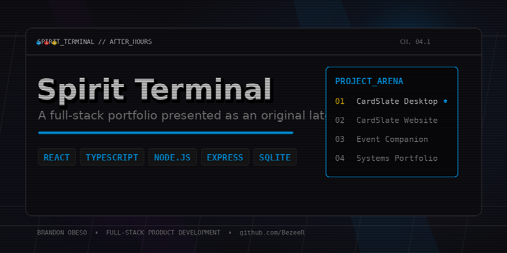

<p align="center"></p>

# Spirit Terminal

BezeeR’s product portfolio at **[www.bezeer.app](https://www.bezeer.app/)**. A late-night broadcast workspace for full-stack products, practical tools, and original games.

## Featured work

- **CardSlate Desktop** — local-first TCG inventory, pricing, and convention sales; private beta.
- **CardSlate Website** — product story, release gateway, and support.
- **Event Companion** — phone-ready convention inventory and checkout.
- **TCG Buds Storefront** — authorized creator-brand storefront demo, content, catalog, and Deck Lab.
- **StratBoard** — a local-first CS2 tactical planner with real radar maps and saved playbooks.
- **[TCG Buds Sim](https://www.bezeer.app/#tcg-buds-pack-night)** — the OPTCG tabletop and Pack Night experience. Includes direct card play, DON!!, battle responses, Practice CPU profiles, five curated Sim Decks, virtual packs, collection, progression, and social Pack Battles. The portfolio opens an in-page gallery of labeled interface illustrations; full Discord identity and social-room features require the Activity. This is a fan simulator in development, with gameplay-only Berries and cards.
- **[Afterhours](https://www.bezeer.app/#afterhours)** — an original multiplayer market-survival Discord Activity. Fictional CR, shared liquidity, protected trading, reserved orders, portfolio risk feedback, private watchlists, XP, and cosmetics. **Private alpha; Discord playtesting is pending.** The gallery combines the previously published alpha trading capture with clearly labeled feature illustrations for charts, P/L, linked exits, and market news. CR has no real-money value or cash-out.

The Systems Portfolio tab explains this site itself. Every project has a direct hash link, keyboard-accessible navigation, and an in-portfolio viewer. Swipe through scenes, use the scene strip or arrow keys, and expand screenshots without downloading an app or signing in. Illustrations remain labeled; see [showcase media and verification](docs/showcase-media.md).

## Run locally

Use Node **22.12+ or 24** and npm.

```bash
npm ci
npm run dev
```

The client runs on `http://localhost:5173`; Vite proxies `/api` to the server on port 5174. No database, account, or secrets are required.

## Verify and build

```bash
npm run build
npm test
npx playwright install chromium
npm run test:browser
npm audit
```

On Linux CI, use `npx playwright install --with-deps chromium`. To reuse an installed Chromium, set `PORTFOLIO_BROWSER_EXECUTABLE_PATH` to its executable path. Browser checks cover all eight project entries at 14 viewports from 320px to 1920px, plus keyboard navigation, deep links, contact-dialog focus, blocked browser storage, and first-visit / returning-visit music behavior. Screenshots and failure details are written to the ignored `test-results/` directory. YouTube is mocked in the playback regression; external playback still depends on the visitor’s browser and YouTube availability.

`npm run build` type-checks the app and server, creates Vite assets, and generates Brotli/gzip copies of JavaScript and CSS. Start the production server with:

```bash
npm start
```

`PORT` overrides the default 5174. `/api/health` reports the portfolio version.

## Architecture

- **React 19 + TypeScript + Vite** for the project workspace.
- **First-visit broadcast intro** with immediate music/quiet entry. Touch visitors get “Enter & Open Radio,” followed by a tap in the video; desktop visitors get “Enter with music.” The animation never disables entry, and reduced-motion visitors get the completed log.
- **Bundled project content**, avoiding a duplicate content API request.
- **Express** serves the production build and health check with security headers.
- **Brotli/gzip** delivery and immutable caching for fingerprinted assets; HTML and unversioned previews revalidate.
- **CSS atmosphere**, static on compact screens and reduced-motion aware. Hidden tabs pause background motion and audio.
- **YouTube IFrame API** for the Nujabes set. Touch entry prepares the visible player and brings its native Play control into view, without a delayed autoplay attempt. Desktop music entry requests playback. Return visits skip the intro; enabled touch visits prepare native Play, while enabled desktop visits attempt autoplay. Explicit Play on a ready player runs directly in the click handler. Playback controls and a native Play fallback remain accessible; no browser policy is bypassed.
- **Direct Discord/GitHub contact** through a native modal dialog. No names, email addresses, or messages are collected or stored by this site.
- **GitHub Actions** checks build, HTTP behavior, dependencies, accessibility, and browser regressions.

The portfolio has no Supabase connection. Supabase appears in case-study stacks for the products that actually use it. The old SQLite contact inbox and `/api/projects` fetch were removed in v0.5 because they added no delivery workflow or durable storage.

## Intro and music preferences

The intro is shown once per browser, with session storage as a fallback. If both forms of storage are blocked, entry still works but the preference cannot survive a reload. “Enter quietly” and Escape enter without loading YouTube. A later explicit Play enables music again. Pausing through either the portfolio or the YouTube player, or collapsing the dock, remembers a quiet return. Volume remains saved separately.

First visits do not load YouTube until music is chosen. Returning visits with music enabled load it automatically, so those visits may make third-party requests. Touch devices with a coarse primary pointer and no hover use native tap-to-play rather than promising audible autoplay. Opening radio explicitly reveals and focuses the player; preparing it on return does not scroll away from the projects. A blocked custom Play attempt also reveals the native control. Desktop autoplay depends on browser permissions and prior interaction. The visible YouTube player stays at least 200×200px, and its status reflects actual playback.

## Project destinations

Optional **build-time** overrides accept HTTPS URLs without embedded credentials:

```env
VITE_TCG_BUDS_URL=https://tcgbuds.bezeer.app/
VITE_STRATBOARD_URL=https://stratboard-six.vercel.app/
```

Invalid overrides fall back to the built-in verified project URLs. Discord projects intentionally have no public play link until a verified launch destination is ready. CardSlate Desktop links to its product page; it never starts a download automatically.

## Deploy

The GitHub `main` branch is linked to Railway. `railway.json` selects the multi-stage Docker build, `/api/health` check, and restart policy. The Docker runtime contains the build and server only; no database or persistent volume is required. Wait for Railway **SUCCESS**, verify the health endpoint and page, and confirm GitHub CI before reporting a release complete.

See [Railway deployment](RAILWAY-DEPLOY.md), [responsive QA](RESPONSIVE-QA.md), and [security review](SECURITY-REVIEW.md).

## Contact and usage

GitHub: [@BezeeR](https://github.com/BezeeR) · Discord: `bezeer` (`171078389166243840`).

No open-source license is included. Publicly viewable source retains standard copyright protection.
